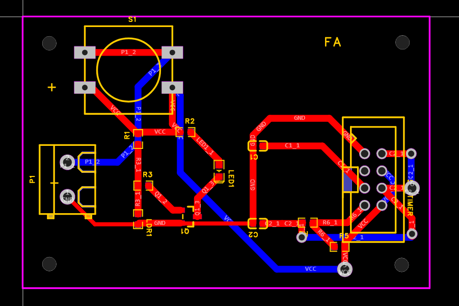
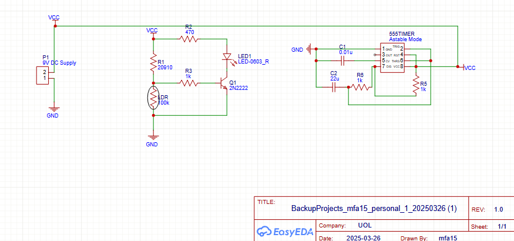

# LDR Night-Light PCB

**University electronics coursework | EasyEDA | Schematic design and PCB layout**

Designed a light-sensitive night-light circuit in EasyEDA, from an initial schematic to a routed board layout. The coursework integrates **light detection, transistor switching and a 555 timer stage** within a **50 × 50 mm board-size constraint**.



## Project objectives

- Create a schematic with an LDR sensing stage, transistor switching and a 555 timer.
- Select appropriate footprints and translate the schematic into a compact PCB layout.
- Arrange components and power connections within the board outline.
- Route the connections and make the layout understandable through component placement and labels.

## 1. Circuit schematic



The schematic was developed in **EasyEDA**. The principal functional blocks are:

| Circuit block | Intended role |
| --- | --- |
| **LDR sensing network** | Changes electrical response with ambient illumination |
| **Transistor switching stage** | Converts the sensor network's response into a switching action |
| **555 timer section** | Provides the circuit's timing/control function |
| **Power and ground** | Supplies the component network and provides return connections |

The screenshot documents component selection and connectivity. It does **not** establish a measured light threshold, timing constant or verified physical switching response.

## 2. PCB design and routing


The circuit was transferred from the schematic to a PCB using assigned footprints. Component placement and routing were completed within the **50 × 50 mm** coursework envelope.

**Layout considerations:**

- Place the sensing, switching and timer components so related signals remain easy to follow.
- Route power and ground connections to the required devices.
- Separate traces between layers when useful to resolve routing conflicts.
- Keep silkscreen and component labels legible.
- Respect the board outline and component footprint clearances.

The image is a **PCB design screenshot**; it is not a photograph of a manufactured board.

## 3. Design workflow

1. Draw the initial circuit schematic in EasyEDA.
2. Assign/verify component footprints.
3. Transfer components to the PCB editor.
4. Arrange components within the size constraint.
5. Route copper tracks and review the resulting layout.
6. Export screenshots for the coursework record.

## 4. Engineering lessons

- **Schematic-to-PCB translation:** electrical connections must remain consistent after assigning physical footprints.
- **Layout trade-offs:** compact dimensions constrain trace routing and placement.
- **Documentation:** a clearly labelled PCB is easier to assemble and diagnose.
- **Verification:** a complete layout is not equivalent to electrical performance testing.

## Scope and limitations

**Completed:** EasyEDA circuit schematic and routed PCB design with the original documentation images.

**Not demonstrated in the supplied coursework record:** physical PCB fabrication, measured LDR switching threshold, oscilloscope verification, timer-frequency measurements, electrical reliability or long-term operation. These have not been claimed.

## Files

```text
LDR-Night-Light-PCB/
├── README.md
└── Images/
    ├── night-light-schematic.png
    └── night-light-layout.png
```

Original EasyEDA source files can be added here later if retained; the current package contains **screenshots and documentation**, not editable EasyEDA project files.

## Related links

- [Portfolio case study](https://farhan10904.github.io/engineering-portfolio/project.html?id=night-light)
- [Engineering portfolio](https://farhan10904.github.io/engineering-portfolio/)
